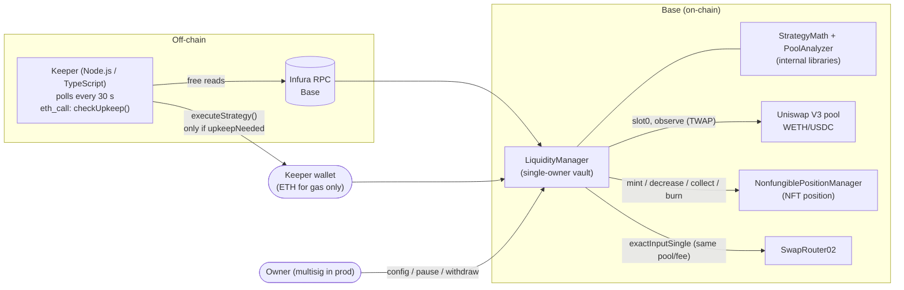
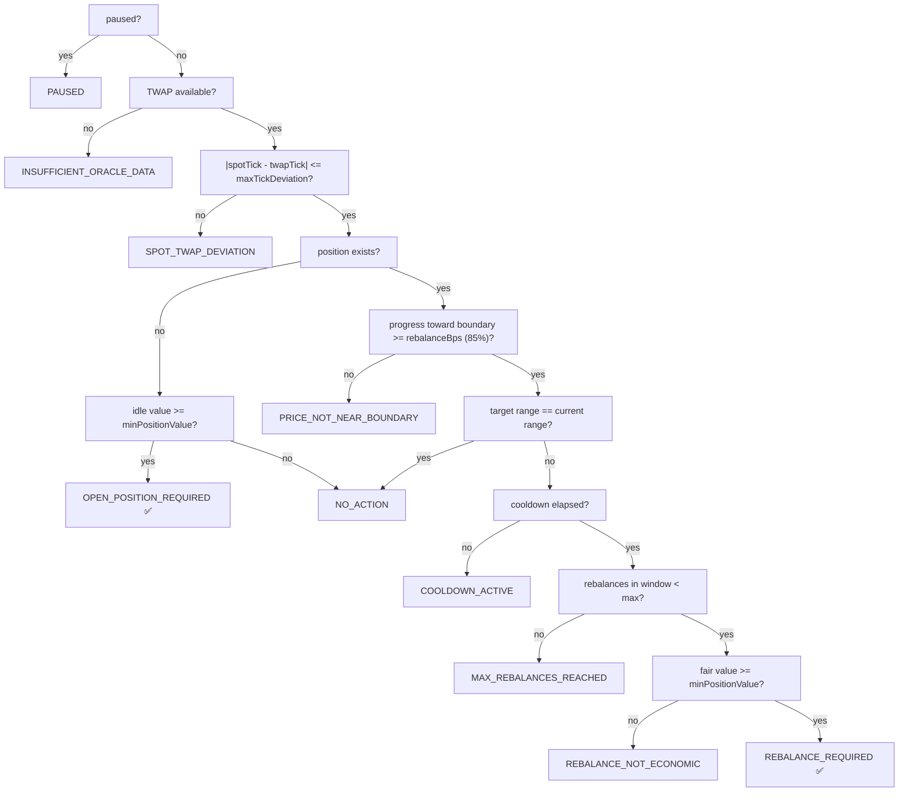

# Architecture

## Components



## Who can do what

| Action | Owner | Keeper (allow-listed) | Anyone |
|---|:-:|:-:|:-:|
| `checkUpkeep()`, `getStrategyState()` (view) | ✔ | ✔ | ✔ |
| `executeStrategy()` (no parameters) | ✔ | ✔ | ✘ |
| `updateStrategyConfig`, `setFeeTier`, `setKeeper` | ✔ | ✘ | ✘ |
| `pause` / `unpause` | ✔ | ✘ | ✘ |
| `withdraw`, `claimFees`, `closePosition`, `emergencyWithdrawAll`, `depositETH` | ✔ | ✘ | ✘ |
| Transfer WETH/USDC into the contract (deposit) | ✔ | ✔ | ✔ (it becomes owner's capital) |

Ownership uses `Ownable2Step` (new owner must `acceptOwnership()`); `renounceOwnership()` is disabled.

## Decision flow (`checkUpkeep` == the first half of `executeStrategy`)



**Optional regime gate (after the oracle/deviation checks, before opening/rebalancing):** if the current UTC hour is in `quietHoursMask`
(weekday-only if configured) or the latched realised volatility is high, the result is `ENTER_FLAT_*` (position exists: close it, swap to the
configured WETH/USDC mix, hold) or `FLAT_*` (already out). When both clear, the normal `OPEN_POSITION_REQUIRED` path re-opens. Off by default.

`progress` = `|2*spotTick - (lower+upper)| / (upper-lower)` in bps, measured in tick (log-price) space: 0 at the range
centre, 10000 at a boundary (or beyond). 70 % (`evaluationBps`) only changes the reported `Status` (`EVALUATION_ZONE`);
85 % (`rebalanceBps`) is the first point where an action can happen, and the other gates still have to pass.

## Atomic rebalance (`executeStrategy` → `_rebalance`)

1. Re-run the whole evaluation inside the transaction (never trust the keeper's earlier read).
2. Verify the NFT is owned by the contract and matches the configured pool/fee (`_readPosition`).
3. `valueBefore` = idle capital + position principal, **priced at the TWAP**.
4. `decreaseLiquidity(all)` → `collect(max)` → `burn`. Fees = collected − principal; reserved unless `reinvestFees`.
5. `StrategyMath.computeSwap` sizes the single swap; `amountOutMinimum` comes from the **TWAP quote × (1 − slippage)**.
   Exact approval → `exactInputSingle` on the configured pool/fee only → approval reset to 0.
6. Re-check spot vs TWAP (sandwich guard) → `mint` with all idle capital → approvals reset to 0.
7. `valueAfter` re-priced at the TWAP; **revert** if `valueAfter < valueBefore × (1 − maxSlippageBps)`.
8. Update `tokenId`, cooldown timestamp and window counter; emit `PositionRebalanced`, `PositionCreated`, plus the
   intermediate events. Any failure reverts everything (verified in the E2E "atomic revert" scenario).

## Events (accounting for the off-chain reports)

`PositionCreated`, `PositionRebalanced` (old/new ticks, spot, TWAP, progress, value before/after),
`PositionLiquidityRemoved`, `FeesCollected`, `SwapExecuted` (in/out/min-out), `StrategyConfigUpdated`, `FeeTierUpdated`,
`KeeperUpdated`, `StrategyPaused/Unpaused`, `ExecutionSkipped`, `EmergencyAction`, `Withdrawn`, `FeesClaimed`.

## Repository layout

```
src/LiquidityManager.sol          main contract
src/libraries/StrategyMath.sol    range, progress, swap sizing (pure integer math)
src/libraries/PoolAnalyzer.sol    slot0 / TWAP
src/interfaces/                   minimal NPM, SwapRouter02, WETH interfaces
script/Deploy.s.sol               Base Sepolia deployment (mainnet refused)
test/StrategyMath.t.sol           unit + fuzz (Foundry)
test/LiquidityManager.fork.t.sol  Base fork tests (Foundry, pinned block)
test/e2e-fork/                    Hardhat-fork end-to-end tests (what was actually executed here)
config/addresses.json             verified external addresses + sources
keeper/                           TypeScript keeper + verifyConfig script
docs/                             this folder
lib/                              vendored dependencies (OpenZeppelin, Uniswap v3 0.8 branches, forge-std)
```
